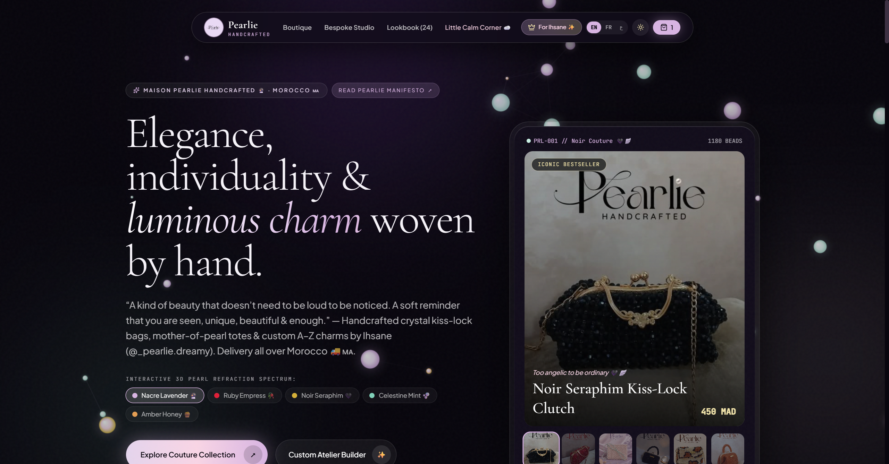
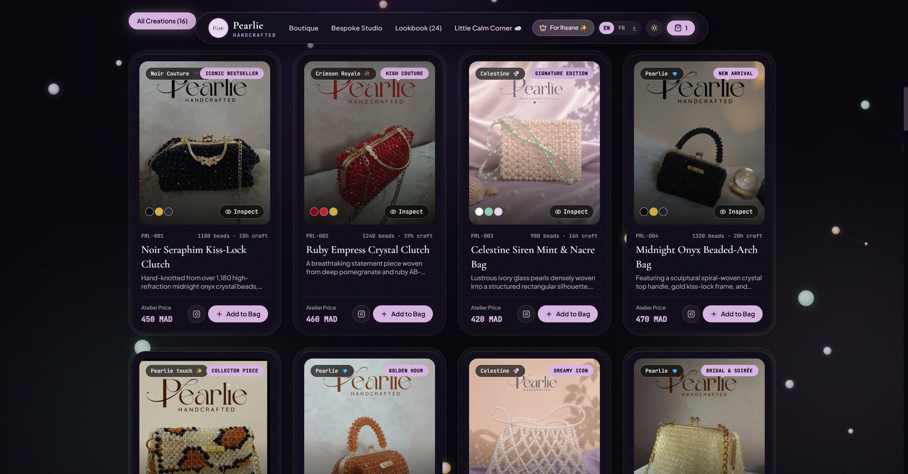
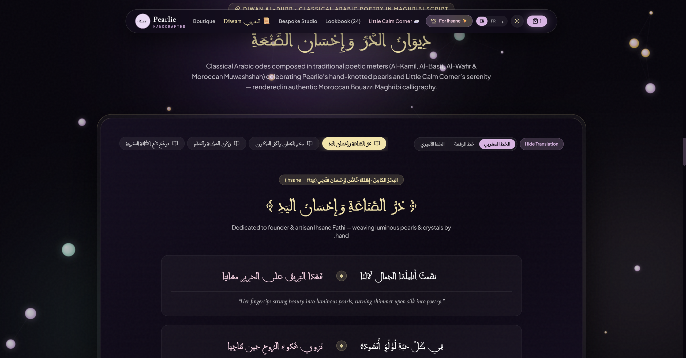
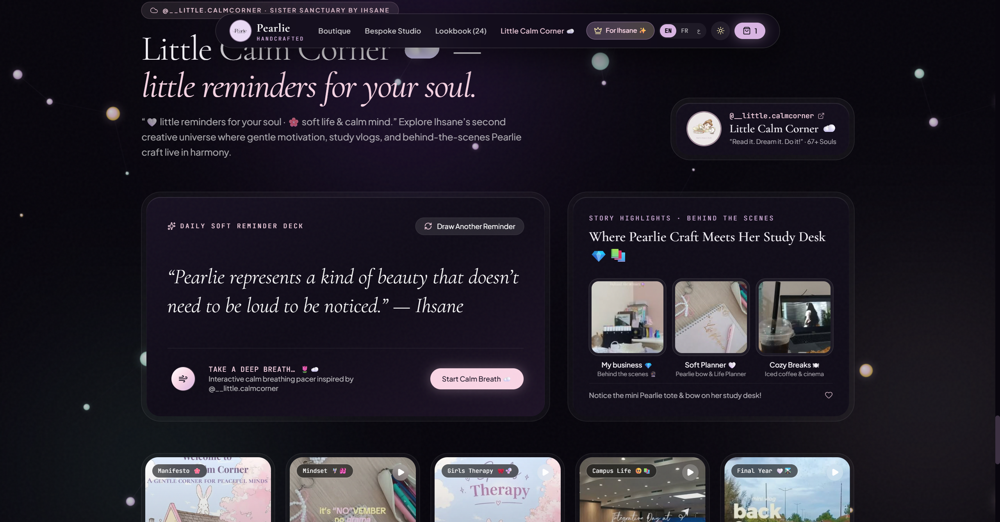
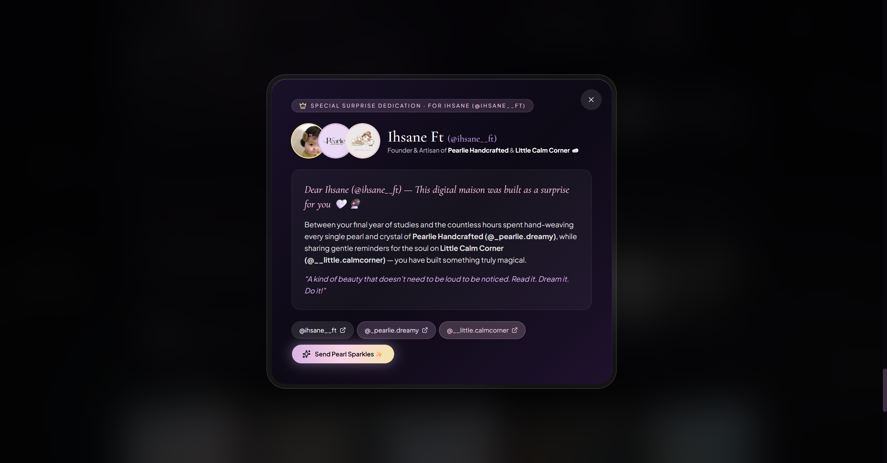

# Pearlie Handcrafted 🔮 × Little Calm Corner ☁️ — Digital Maison

> An interactive, futuristic Pearlescent Haute-Couture web experience, 3D pearl light-refraction canvas, and bespoke customizer uniting **Pearlie Handcrafted (`@_pearlie.dreamy`)** and **Little Calm Corner (`@__little.calmcorner`)** — crafted for founder & software engineer **Ihsane FATHI (`@IhsaneFathi` / `@ihsane__ft`)** in English, French, and Arabic.

**Live Production (GitHub Pages):** [https://bosaj.github.io/pearlie-dreamy-atelier/](https://bosaj.github.io/pearlie-dreamy-atelier/)  
**WhatsApp Atelier Concierge:** [https://wa.me/message/HYSIBOQVMTCAE1](https://wa.me/message/HYSIBOQVMTCAE1)  
**Status:** v1.3.0 · **Owner & Founder:** [Ihsane FATHI (`@IhsaneFathi` / `@ihsane__ft`)](https://github.com/IhsaneFathi)

[](https://github.com/Bosaj/pearlie-dreamy-atelier/actions/workflows/ci.yml)
[](https://bosaj.github.io/pearlie-dreamy-atelier/)
[](https://github.com/Bosaj/pearlie-dreamy-atelier/releases/latest)
[](LICENSE)



---

## What It Does

- **Interactive 3D Pearl & Crystal Light-Refraction Field (`src/components/PearlFieldCanvas.tsx`)** — A 60fps HTML5 Canvas simulation rendering floating mother-of-pearl and faceted crystal spheres with cursor spring-repulsion physics and 5 switchable light spectrums:
  - *Nacre Lavender* (`nacre`)
  - *Ruby Empress* (`ruby`)
  - *Noir Seraphim* (`noir`)
  - *Celestine Mint* (`mint`)
  - *Amber Honey* (`amber`)
- **La Boutique Pearlie (`#boutique`)** — Complete catalog of **16 handcrafted signature creations** (`PRL-001` to `PRL-016`) across four couture categories (*Crystal Kiss-Lock Clutches*, *Celestine & Elarielle Pearl Totes*, *3D Alphabet A–Z & Coquette Keychains*, and *Mini Cases & Pouches*), complete with multi-angle inspection modals, bead counts, artisan weaving hours, MAD pricing, and direct Instagram post links.
- **Bespoke 3D Atelier Configurator (`src/components/BespokeStudio.tsx`)** — A 6-step custom order builder allowing clients across Morocco (`🚚🇲🇦`) to:
  1. Choose a silhouette (*Crystal Kiss-Lock Clutch*, *Celestine Diamond-Lattice Tote*, *3D Alphabet A–Z Keychain*, *Coquette Pearl Bow*, or *Pearl AirPods Case*).
  2. Pick a custom 3D woven initial (`A` through `Z`).
  3. Select from 7 pearl & crystal color palettes with a live simulated bead-weave preview.
  4. Select hardware & satin ribbon finishes.
  5. Choose their Moroccan delivery city (Casablanca, Rabat, Marrakech, Oujda, Berkane, Tangier, Fes, Agadir, etc.).
  6. Add a custom message for the signature Pearlie thank-you card and send the structured specification straight to WhatsApp (`https://wa.me/message/HYSIBOQVMTCAE1`).
- **24-Post Authentic Instagram Lookbook (`#lookbook`)** — Every real post and reel from [`@_pearlie.dreamy`](https://www.instagram.com/_pearlie.dreamy/) (`DfX7Lo-sICS` through `Db8fJ2pMUFX`) bundled locally in `public/images/` for instant, zero-latency loading.
- **Little Calm Corner ☁️ Sanctuary (`src/components/CalmCornerPortal.tsx`)** — Dedicated portal for Ihsane's sister sanctuary [`@__little.calmcorner`](https://www.instagram.com/__little.calmcorner/) (*“🤍 little reminders for your soul | 🌸 soft life & calm mind”*), featuring:
  - **Daily Soft Reminder Deck** with shufflable bilingual/trilingual affirmations.
  - **Interactive 4–4–6 Calm Breathing Orb** (*Inhale 4s · Hold 4s · Exhale 6s*).
  - **3 Behind-the-Scenes Story Highlights** (*My business 💎*, *Soft Planner 🤍*, *Cozy Breaks 🎬*) and **5 Reels & Posts** including her ENIAD engineering school integration day and final-year study vlogs.
- **Diwan al-Durr — Classical Arabic Poetry & Moroccan Maghribi Calligraphy (`src/components/MaghribiPoetryDiwan.tsx`)** — Dedicated Arabic poetic pavilion (`#diwan`) featuring 4 classical Arabic poems (*Bahr al-Kamil*, *Bahr al-Basit*, *Bahr al-Wafir*, and *Al-Muwashshah al-Maghribi*) composed in honor of **Ihsane (`@ihsane__ft`)**, **Pearlie Handcrafted**, and **Little Calm Corner**, rendered in authentic **`Bouazzi Maghribi`** script (`public/fonts/BouazziMaghribi-Regular.woff2`) with a live 3-calligraphy switcher (`الخط المغربي` / `خط الرقعة` / `الخط الأميري`), translation toggle, and 1-click poem copy.
- **Founder & Artisan Surprise Dedication (`src/components/FounderSurpriseModal.tsx`)** — Dedicated tribute to **Ihsane FATHI (`@IhsaneFathi` / `@ihsane__ft`)** with celebratory pearl sparkles, Maghribi calligraphic couplets, and trilingual dedication letters (`EN` / `FR` / `ع`).
- **Trilingual (`EN` / `FR` / `AR`) & Universal Phone Responsiveness (`320px–430px`)** — Instant switching between English, French, and Arabic (with native RTL layout, `Bouazzi Maghribi` & `Readex Pro` typography) plus *Obsidian Nacre* (dark couture) and *Cloud Silk* (daylight ivory) themes, engineered with zero horizontal overflow across all phone displays.

---

## Visual Tour

| La Boutique Pearlie (`#boutique`) | Diwan al-Durr — `Bouazzi Maghribi` Poetry (`#diwan`) |
|---|---|
|  |  |

| Little Calm Corner ☁️ (`#calm-corner`) | Founder Surprise Dedication (`@ihsane__ft`) |
|---|---|
|  |  |

---

## Asset & Archive Integrity

Every photograph, highlight cover, and reel cover is verified in CI (`npm run verify:assets` and `npm test`):

| Source Account | Bundled Assets | Verification Check |
|---|---|---|
| **`@_pearlie.dreamy`** | 7 Story Highlights + 24 Feed Posts/Reels + 16 Multi-Angle Product Galleries | Verified via `scripts/verify-assets.mjs` |
| **`@__little.calmcorner`** | Avatar + 3 Story Highlights + 5 Feed Posts/Reels | Verified via `scripts/verify-assets.mjs` |
| **`@ihsane__ft`** | Founder Portrait & Co-Brand Badges | Verified via `scripts/verify-assets.mjs` |

---

## Tech Stack & Architecture

- **Framework:** React 19 + TypeScript 5.8 + Vite 6
- **Styling & Design System:** Tailwind CSS v4 (`@tailwindcss/vite`), Double-Bezel (*Doppelrand*) card architecture, detached Floating Glass Island navbar, custom spring cubic-bezier easings (`cubic-bezier(0.23, 1, 0.32, 1)`), and GPU-safe film grain.
- **Typography:** `Bouazzi Maghribi` (Traditional Moroccan Mabsut Calligraphy), `Aref Ruqaa` & `Amiri` (Classical Arabic Poetry), `Cormorant Garamond` (Editorial Display), `Plus Jakarta Sans` (UI Body), `JetBrains Mono` (Atelier Codes & MAD Pricing), and `Readex Pro` (Arabic RTL UI).
- **Testing & Asset Auditing:** Node.js native test runner (`tests/atelier.test.mjs`) + automated local media verifier (`scripts/verify-assets.mjs`).
- **CI/CD & Deployment:** GitHub Actions (`ci.yml` + `deploy.yml`) deploying automatically to GitHub Pages.

```text
public/images/                      60 authentic local photos & reel covers from Instagram
src/data/atelierData.ts             16 products, 7 highlights, 24 Pearlie posts, 5 Calm Corner posts
src/components/PearlFieldCanvas.tsx Interactive 60fps 3D pearl & crystal light-refraction canvas
src/components/BespokeStudio.tsx    6-step custom bag & A–Z keychain configurator + WhatsApp spec
src/components/CalmCornerPortal.tsx Little Calm Corner ☁️ affirmation deck, breathing orb & reels
src/components/FounderSurpriseModal.tsx Surprise dedication modal & sparkle celebration for Ihsane
src/App.tsx                         Main application, Boutique, Lookbook, Modals & Checkout Drawer
scripts/verify-assets.mjs           CI verifier checking every referenced image path on disk
tests/atelier.test.mjs              Automated test suite for catalog completeness & trilingual keys
```

---

## Getting Started (For `@IhsaneFathi` & Contributors)

```bash
# Clone the repository
git clone https://github.com/Bosaj/pearlie-dreamy-atelier.git
cd pearlie-dreamy-atelier

# Install dependencies
npm install

# Start local development server (with instant Hot Module Replacement)
npm run dev

# Verify TypeScript types
npm run typecheck

# Audit all 60 Instagram & Atelier media assets in public/images/
npm run verify:assets

# Run automated test suite
npm test

# Build production bundle
npm run build
```

> 💡 **Developer Tip for Ihsane (`@IhsaneFathi`):** To add a new bag or keychain, drop the photo into `public/images/` and add an entry to `PEARLIE_PRODUCTS` in [`src/data/atelierData.ts`](src/data/atelierData.ts). Pushing to `main` automatically runs CI and deploys the live site to [https://bosaj.github.io/pearlie-dreamy-atelier/](https://bosaj.github.io/pearlie-dreamy-atelier/)! See the [Wiki Developer Guide](https://github.com/Bosaj/pearlie-dreamy-atelier/wiki/Developer-Setup-for-Ihsane) for step-by-step examples.

---

## Versioning & Governance

This project follows [Semantic Versioning](https://semver.org/) (`vX.Y.Z`). Every release has a matching Git tag, GitHub Release, Milestone, and entry in [CHANGELOG.md](CHANGELOG.md).

- **Owner & Admin:** [Ihsane FATHI (`@IhsaneFathi`)](https://github.com/IhsaneFathi)
- **Documentation:** [GitHub Wiki](https://github.com/Bosaj/pearlie-dreamy-atelier/wiki) · [Changelog](CHANGELOG.md) · [Contributing](CONTRIBUTING.md) · [Security Policy](SECURITY.md)
- **License:** [Proprietary Commercial License — All Rights Reserved (`Pearlie Handcrafted` & `Little Calm Corner` — Ihsane FATHI)](LICENSE) — *Private commercial property; unauthorized copying, redistribution, or commercial use is strictly prohibited.*
