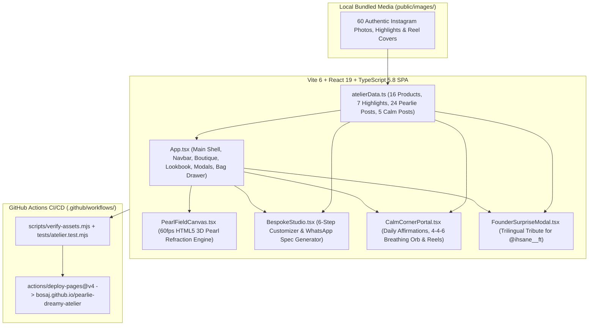

# 1. Architecture & Pearlescent Haute-Couture Design System

## High-Level System Architecture

---

## Aesthetic Direction: *Obsidian Nacre* & *Cloud Silk*

The interface is engineered to showcase both **faceted midnight/ruby crystal bags** and **luminous ivory/mint mother-of-pearl totes**:

| Token / Mode | Obsidian Nacre (Default Dark Mode) | Cloud Silk (Daylight Mode) |
|---|---|---|
| **Primary Canvas** | `#09060E` (Deep Velvet Obsidian) | `#FAF6F0` (Warm Mother-of-Pearl Ivory) |
| **Elevated Surface** | `rgba(255, 255, 255, 0.04)` with `backdrop-blur-2xl` | `rgba(255, 255, 255, 0.85)` with `ring-stone-200` |
| **Primary Accent** | `#D8B4E2` (Elarielle Lavender Silk) | `#6B21A8` (Regal Amethyst) |
| **Secondary Accent** | `#F3E5AB` (Champagne Gold Kiss-Lock) | `#92400E` (Warm Brushed Gold) |

---

## Double-Bezel (*Doppelrand*) Card Architecture

Every product card, modal, and interactive studio container uses a two-layer nested bezel:
- **Outer Shell**: `p-1.5 rounded-[2rem] bg-white/[0.03] ring-1 ring-white/10`
- **Inner Core**: `rounded-[calc(2rem-0.375rem)] shadow-[inset_0_1px_1px_rgba(255,255,255,0.18)]`

---

## Typography Hierarchy

- **Editorial Display (`--font-display`)**: `'Cormorant Garamond', Georgia, serif` — High-contrast luxury fashion headlines.
- **UI Body (`--font-sans`)**: `'Plus Jakarta Sans', sans-serif` — Clean geometric legibility for descriptions and controls.
- **Technical Specs (`--font-mono`)**: `'JetBrains Mono', monospace` — Used for product codes (`PRL-001`), bead counts (`1180 BEADS`), craft hours, and `MAD` pricing.
- **Arabic RTL (`--font-arabic`)**: `'Readex Pro', sans-serif` — Native Arabic rendering when `lang === 'ar'`.
